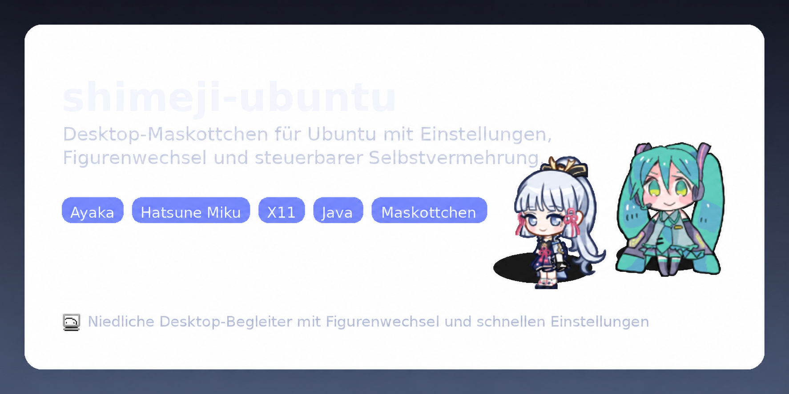

# shimeji

<p align="center">
  
</p>

<p align="center">
  
</p>

<p align="center">
  <a href="https://github.com/ngoc-thu/shimeji/releases/latest">⬇ Neueste Version herunterladen</a>
</p>

Eine moderne, praktische Anwendung mit Desktop-Maskottchen (Shimeji) für **Windows 10/11 und Linux**. Sie bietet eine native Windows-API-Anbindung, eigenständige `.exe`-Startprogramme, Korrekturen für die DPI-Skalierung und eine integrierte Einstellungsoberfläche.

---

## ✨ Funktionen

- **Eigenständige Windows-Programme**:
  - `Shimeji.exe`: Startprogramm mit Maskottchensymbol; startet ohne schwarzes Konsolenfenster.
  - `ShimejiSettings.exe`: Eigenständiges Programm für die Einstellungen.
- **Native Windows-API-Anbindung**:
  - Erfassung der Fenster, Erkennung des aktiven Fensters und Kollisionserkennung an der Taskleiste über JNA (`User32` / `GDI32`).
- **Korrekturen für hohe DPI-Skalierung und Bewegungsphysik**:
  - Behebt fehlerhafte Bodenkollisionen und endloses Fallen bei skalierten Windows-Anzeigen (100 %, 125 %, 150 %, 200 %).
  - Eine Toleranz von ±2 Pixeln bei Boden- und Wandgrenzen ermöglicht sanftes Landen.
- **Integrierte Einstellungsoberfläche**:
  - `ShimejiSettings.exe` / `shimeji_settings.py` (Python mit Tkinter).
  - Einfacher Figurenwechsel, Bearbeitung des Fensterversatzes in `window.conf`, Fensterfilter in `titles.conf` und Schalter für die Selbstvermehrung.
- **Mitgelieferte Figuren**:
  - **Ayaka** und **Hatsune Miku**.
- **Plattformübergreifende Unterstützung**:
  - Unterstützung für **Windows 10/11** und **Ubuntu / Linux mit X11**.

---

## 🎭 Mitgelieferte Figuren

<table>
  <tr>
    <td align="center"><strong>Ayaka</strong></td>
    <td align="center"><strong>Hatsune Miku</strong></td>
  </tr>
  <tr>
    <td align="center"></td>
    <td align="center"></td>
  </tr>
</table>

---

## 🚀 Schnellstart

### Unter Windows
1. Stelle sicher, dass **Java 8 oder neuer** (empfohlen: JDK 19 oder 21) und **Python 3.x** installiert sind.
2. **Maskottchen starten**: Doppelklick auf `Shimeji.exe` oder `launch.bat`.
3. **Einstellungen öffnen**: Doppelklick auf `ShimejiSettings.exe` oder `run-settings.bat`.

### Unter Linux
```bash
# Maskottchen starten
./launch.sh

# Einstellungsoberfläche starten
./run-settings.sh
```

---

## 🛠️ Aus dem Quelltext erstellen

### Unter Windows
Führe `build.bat` direkt in der Eingabeaufforderung oder in PowerShell aus. Eine Ant-Installation ist nicht erforderlich:

```cmd
build.bat
```

Dabei werden alle Java-Quellen (`src`, `src_generic`, `src_x11`, `src_win`) kompiliert und in `Shimeji.jar` gepackt. Anschließend werden `Shimeji.exe` und `ShimejiSettings.exe` mit `csc.exe` erstellt.

### Unter Linux
```bash
ant clean jar
```

---

## 📁 Eigene Figuren hinzufügen

So fügst du eine neue Figur hinzu:

1. Erstelle einen neuen Ordner unter `characters/DEIN_FIGURENNAME/`.
2. Lege darin die Dateien `shime1.png` bis `shime46.png` ab.
3. Öffne `ShimejiSettings.exe` oder führe `python shimeji_settings.py` aus.
4. Wähle deine neue Figur aus der Auswahlliste.
5. Klicke auf **Figur übernehmen** oder **Übernehmen + Neustart**.

---

## ⚙️ Konfigurationsdateien

- **`window.conf`**: Anpassungen des Fensterversatzes in der Reihenfolge `x`, `y`, `Breitenzuschlag`, `Höhenzuschlag`.
- **`titles.conf`**: Filtert Zielfenster anhand ihres Titels. Ein Titel pro Zeile; leer lassen, um alle aktiven Fenster zu verwenden.
- **`settings.properties`**: Speichert Verhaltenseinstellungen, zum Beispiel `selfCloningEnabled=true|false`.

---

## 📜 Lizenz und Danksagung

Dieses Projekt übernimmt die ZLIB/LIBPNG-Lizenz des ursprünglichen Shimeji-Projekts von Yuki Yamada (Group Finity). Der Lizenztext steht im [Original](LICENSE) und als [deutsche Übersetzung](LICENSE.de) zur Verfügung.

- **Java Native Access (JNA)**: Unter der LGPL lizenziert.
- **Mozilla Rhino JS Engine**: Unter der MPL lizenziert.
